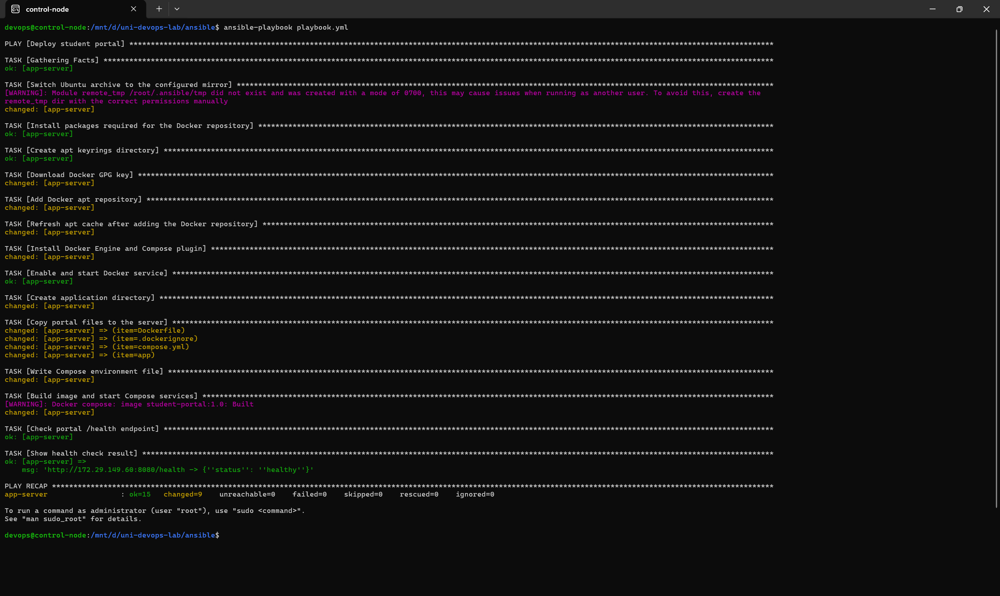
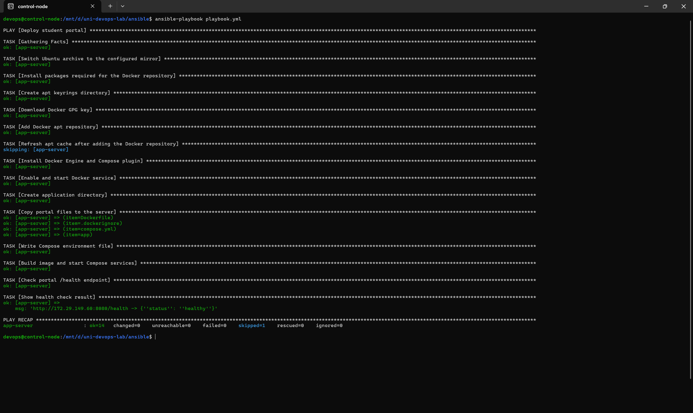
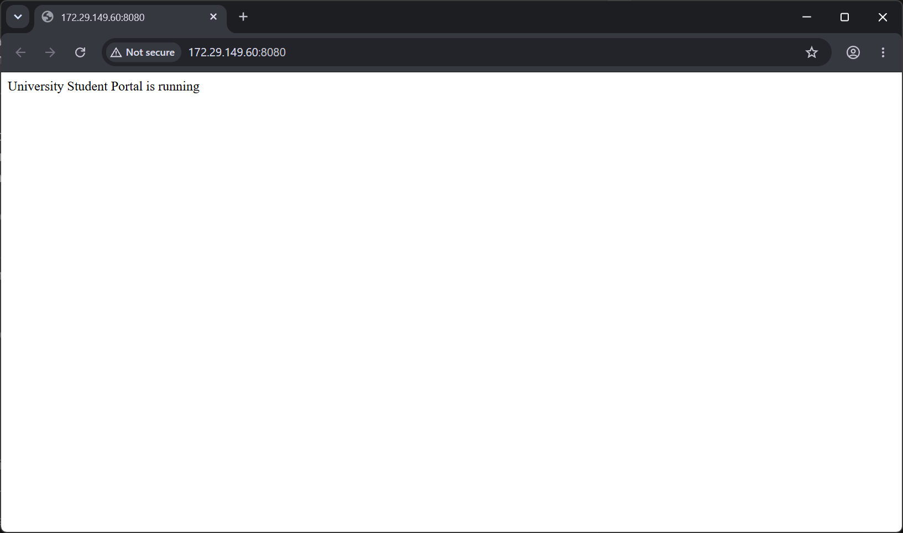
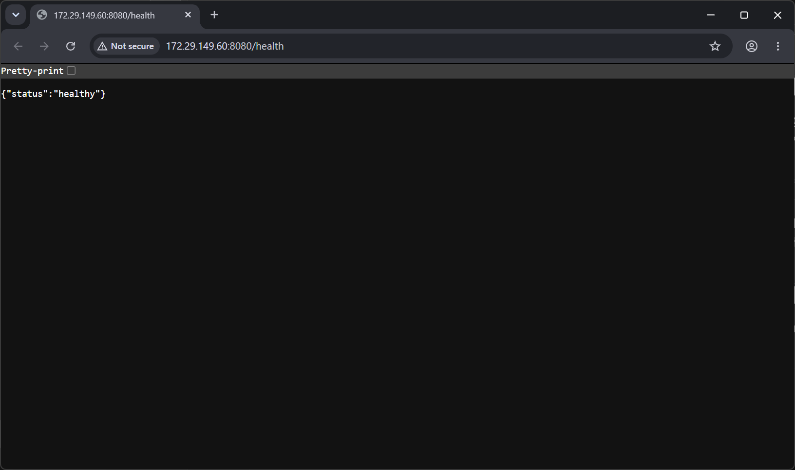
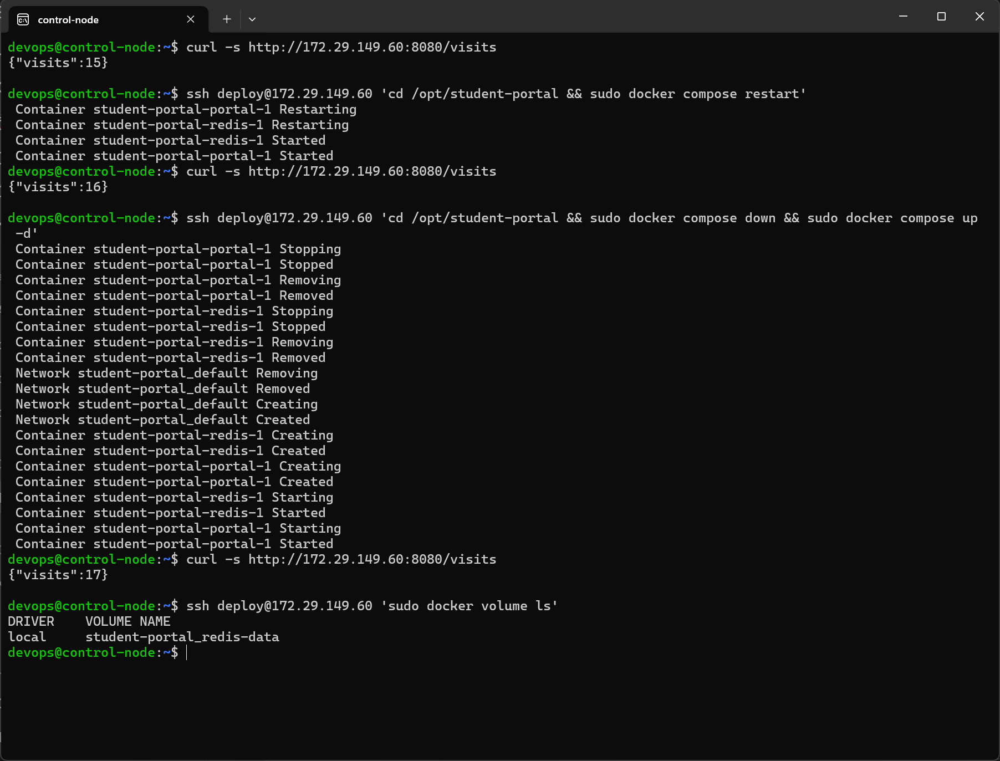

# uni-devops-lab

Universitet tələbə portalı (Flask + Redis) üçün DevOps praktikası. Kod Git-də branch və pull request-lərlə idarə olunur, portal Docker ilə paketlənir, app server-ə isə Ansible ilə avtomatik qurulur. Serverdə əl ilə heç nə quraşdırılmır.

## Mühit

| Rol | Sistem | Qeyd |
|---|---|---|
| Control node | Ubuntu 24.04 (WSL2) | Ansible core 2.16, community.docker 3.7 |
| App server | Ubuntu 24.04 server cloud image (WSL2), `172.29.149.60` | Yalnız SSH üçün `deploy` istifadəçisi və public key əlavə olunub, paketlərin hamısını playbook quraşdırır |

WSL yenidən başladıqda server IP-si dəyişə bilər. Bu halda `ansible/inventory.ini`-də `ansible_host` yenilənir.

## Struktur

```
app/          Flask tətbiqi (app.py) və asılılıqlar (requirements.txt)
ansible/      Inventory, playbook və dəyişənlər
Dockerfile    Portal image-i (python:3.12-slim)
compose.yml   Portal + Redis, named volume
screenshots/  Playbook icraları və portalın ekran görüntüləri
```

## Lokal işə salma

```bash
docker build -t student-portal:1.0 .
docker compose up -d
curl http://localhost:8080/health
curl http://localhost:8080/visits
```

Portal konteynerdə 5000 portunda işləyir, xaricə 8080 portu ilə açılır. Redis-ə `redis` servis adı ilə qoşulur (`REDIS_HOST`). Redis datası `redis-data` named volume-da saxlanılır, ona görə `docker compose restart` və ya `down`/`up`-dan sonra `/visits` sayı sıfırlanmır.

Port və image adı `PORTAL_PORT` və `PORTAL_IMAGE` dəyişənləri ilə dəyişdirilə bilər (default: `8080`, `student-portal:1.0`).

## Serverə quraşdırma (Ansible)

```
ansible/
  ansible.cfg                 SSH və inventory ayarları
  inventory.ini               app server (IP, istifadəçi)
  group_vars/app_servers.yml  port, image adı, qovluq yolu, Docker paketləri, apt mirror
  playbook.yml
  templates/env.j2            Compose üçün .env (port və image adı)
```

Control node-un public key-i app server-dəki `deploy` istifadəçisinin `authorized_keys` faylındadır, qoşulma şifrəsiz SSH ilə gedir. Private key repository-də saxlanılmır.

```bash
cd ansible
ansible app_servers -m ping
ansible-playbook playbook.yml
```

Playbook ardıcıllıqla:

1. Docker-in rəsmi apt repository-sini əlavə edir, Docker Engine və Compose plugin-i quraşdırır, `docker` servisini aktiv edir.
2. `Dockerfile`, `.dockerignore`, `compose.yml` və `app/` fayllarını `app_dir` qovluğuna köçürür, dəyişənlərdən `.env` yaradır.
3. `docker compose up` edir. Fayllar dəyişibsə image yenidən yığılır, dəyişməyibsə mövcud image istifadə olunur.
4. `http://<server-ip>:<port>/health` cavabını yoxlayıb ekrana çıxarır.

İkinci icrada heç bir task dəyişiklik etmir (`changed=0`).

## Nəticə

Playbook-un birinci icrası (təmiz server):



İkinci icra, dəyişiklik yoxdur:



Portal `http://172.29.149.60:8080`:





`/visits` sayı `docker compose restart` və `down`/`up`-dan sonra davam edir:




## Qarşılaşılan problem

**Playbook ikinci icrada da `changed` göstərirdi.** Serverdə heç nə dəyişməsə də `Build image and start Compose services` task-ı hər dəfə `changed=1` verirdi. `-v` ilə baxanda modulun `actions` siyahısında Redis konteyneri üçün `status: Waiting` hadisəsi görünürdü.

Səbəb `compose.yml`-dəki `depends_on: condition: service_healthy` idi. `docker compose up` hər dəfə Redis-in healthy olmasını gözləyir, `community.docker` 3.7-dəki `docker_compose_v2` modulu isə bu gözləməni dəyişiklik kimi qeyd edir.

Portal Redis-ə ilk `/visits` sorğusunda qoşulur, ona görə başlanğıc sırası üçün sadə `depends_on: [redis]` kifayətdir. Şərt çıxarıldı, Redis healthcheck saxlandı. Bundan sonra ikinci icra `changed=0` ilə bitir.

Bundan başqa, `archive.ubuntu.com` bu şəbəkədən cavab vermirdi və `apt` ilişib qalırdı. Playbook ona görə `ubuntu_mirror` dəyişəni ilə Azərbaycan mirror-una (`az.archive.ubuntu.com`) keçir.
